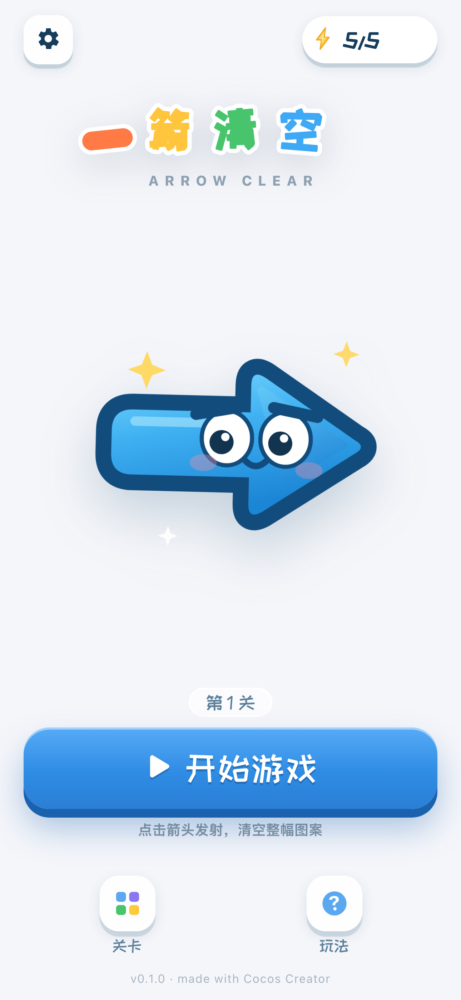
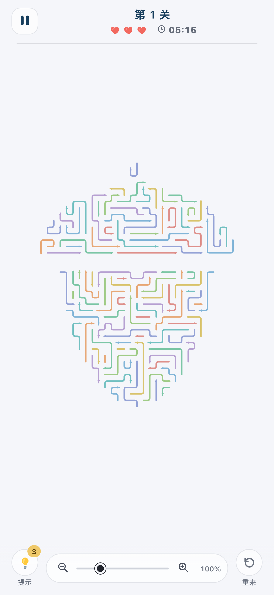

# 一箭清空 · Arrow Clear

> 长蛇形箭阵解谜。点一支箭，它沿着箭头方向飞出棋盘；被别的箭挡住就会「撞墙」。
> 把整块棋盘清空即可过关，撞墙越少星星越多。

[](store/appstore/01-home.png)
[](store/appstore/02-game.png)
[](store/appstore/03-win.png)

---

## 这个仓库里有什么

| 模块 | 路径 | 说明 |
| --- | --- | --- |
| Cocos Creator 3.8.6 工程 | `assets/` `project.json` | iOS / Android / 微信小游戏三端共用 |
| 纯 TS 玩法内核 | `assets/scripts/core/` | 关卡生成、可解性校验、规则、存档，零引擎依赖 |
| Cocos 表现层 | `assets/scripts/cocos/` | 场景、棋盘绘制、UI、动效、音效 |
| 可玩 Web 预览 | `web/` → `dist/web/` | 与 Cocos 共用同一套内核，用于快速验证手感与画面 |
| 美术 / 音频资源 | `assets/resources/` | 全部由脚本生成，可复现 |
| 上架文档 | `docs/` | iOS、Google Play、微信小游戏完整流程 |
| 商店素材 | `store/` | 6.9" / 6.7" 截图、Google Play 特色图、1024 图标 |

---

## 快速开始

### 1. Web 预览（不用装 Cocos，30 秒看效果）

```bash
cd ArrowClear
npm install
npm run web          # 打开 http://localhost:4173
```

打包成静态站点：

```bash
npm run build:web    # 输出 dist/web
```

`dist/web` 可以直接丢到任意静态服务器 / CDN，也可作为商店演示链接。

### 2. Cocos Creator

1. 安装 **Cocos Creator 3.8.6**（Dashboard 里选 3.8.6，不要用 2.x）。
2. Dashboard → 项目 → 添加 → 选择本目录 `ArrowClear`。
3. 打开后双击 `assets/scenes/main.scene`，点右上角 ▶ 预览。
4. 构建：菜单「项目 → 构建发布」，平台选 `iOS` / `Android` / `微信小游戏`。

> 设计分辨率 720×1280，竖屏，`FIXED_WIDTH`。代码里也会强制设置一次，所以换机型不会错位。
> 如果场景打不开，见 [docs/01-快速开始.md](docs/01-快速开始.md) 的兜底方案（30 秒重建场景）。

### 3. 校验

```bash
npm test               # 类型检查 + 3 套测试（1896 项断言，约 3 分钟）
```

单独运行：

```bash
npm run check            # Web + 核心 TypeScript
npm run check:cocos      # Cocos 脚本按官方引擎类型检查
npm run test:core        # 核心规则单测（1820 项：500 关结构 / 冰冻箭 / 体力等）
npm run test:e2e         # 真实 Chrome 端到端（30 项，含激励广告与 5 关实打通关）
npm run test:project     # Cocos 工程静态校验（46 项）
npm run test:levels      # 500 关全量生成 + 可解性校验（含 Boss 三连打部件，约 3 分钟）
```

---

## 玩法

- 棋盘由一条条**长蛇形箭头**铺满，每条箭占若干格，箭头指向出口方向。
- 点击任意一支箭：
  - 箭头正前方到棋盘边缘**没有其它箭** → 整条箭飞出棋盘，格子释放；
  - 前方被挡 → 撞墙，扣 1 颗爱心，箭头抖动。
- 3 颗爱心用完或倒计时归零 → 失败；清空棋盘 → 过关。
- 星级看撞墙次数：0~5% 三星，≤18% 二星，其余一星。
- 「提示」高亮一支当前可飞的箭：初始 3 次，看一段激励广告补 1 次。

### 500 关结构（规则书见 docs/10）

- **5 个世界 × 5 章 × 20 关**：Sunny Meadow → Frozen Castle → Art Gallery → World Tour → Royal Throne。
- 每章节奏模板：章首爽关 → 教学爬坡 → 小歇图案关（L7）→ 冲刺关（L14，限时减半、爱心 5 颗）
  → Boss 关（L19；世界二起为 3 小关连打、爱心贯穿）→ 章末禅意揭画关（L20，无时限无失败）。
- **图案关**：每 10 关一幅剪影画（50 幅：通用符号 → 生活图鉴 → 名画灵感几何再创作 → 世界地标 → 终章华彩），
  棋盘底层铺色，清空即揭画。
- **大眼 Boss 箭**（每关一支，首关除外）：双倍宽蓝色巨箭，占两列格；
  **两条射线（头所在列 + 右侧一列）必须同时畅通才能飞**——头对头就是真堵死，
  必须先给它让出整条两列宽的通道。
- **冰冻箭**（L41 首发）：冰封的箭不能起飞但照常挡道；旁边累计飞走 2 支箭即解冻（冰壳裂纹可见）。
- 章门槛：进入新章需上一章 ≥42/60 星，差星可回刷或看广告领通行证（每章 1 次）。
- 千层箭阵彩蛋关（关卡页 ★ 按钮，id 501）永远可玩。

### DEBUG 模式（调关用）

三种开启方式任选：

- 访问 `http://localhost:4173/?debug=1`；
- 对局中按 **D** 键切换；
- 移动端连续点击首页 **LOGO 5 次**（1.2 秒内）。

面板显示：**链接深度**（拓扑剥洋葱层数）、**棋盘评分 + 等级**、**可释放根数**（实时，含初始值）、
**推进进度**（已清/总数）、**箭头数 + 填充率**，以及五维拆分与密度。
底部按钮：

- **▶ 自动解密**（快捷键 **A**）：按当前合法解 90ms 一支自动清空本关，再点停止；
- **↻ 重置**：重开同一关，方便反复观察解法。

### 关卡质量评分标准（v3 四维，0~100）

| 维度 | 权重 | 口径 |
| --- | --- | --- |
| 形态跨度 | 25 | 巨蟒（≥16 格）数 ×2.2 + 长度标准差 ×1.8 |
| 反斑马线 | 25 | 逐段平行率（满铺基准标定：0.5 满分线） |
| 回字包络 | 25 | 嵌套腔体数 ×1.4（大箭包围内部箭） |
| 深层单解 | 25 | 基线 8 + 单解步/跃迁距/穿针奖励 − 开局可动惩罚 |
| 空格惩罚 | −0~30 | 按填充率计（≥99% 不罚） |

- 等级：≥85 S · ≥75 A · 其余 B；**硬门禁**：大盘 70 / 中盘 68 / 小盘 65，低于自动换种子重摇。
- 生成算法：《大师级连环扣》v3——40~65 格超巨型过山龙 + MRV 死角起笔 + 二步前瞻 + 末端削笔回溯 +
  精简满铺 + 三 pass 漏斗手术（详见 `core/arrowscore.ts`）。
- 全 541 盘实测：**S 141 · A 290 · B 110 · 未达标 0**，均分 80.3；
  主线平均 **142 支箭、最长龙均 49 格、单解步均 36**。
- **DEBUG X-Ray 透视**（`?debug=1` → ✨ 透视，快捷键 X）：跃迁链 ①→⑥ / 连环扣橙框 /
  击尾导流金脊 / 穿针窄门绿线 四图层叠加，盘面精妙设计一眼看穿。
- 逐关明细：[docs/11-关卡指标总表.md](docs/11-关卡指标总表.md) 与
  [docs/全关卡指标汇总.xlsx](docs/全关卡指标汇总.xlsx)（含 541 张盘面截图）。

### 体力

- 上限 5 点，**通关不扣、失败一关扣 1 点**（复活会把这点退回），每 6 分钟自动恢复 1 点，离线也照算。
- 体力不足时开不了新关，可以**看一段激励视频 +1 点**。

### 激励广告（唯一的变现方式，无内购、无金币）

| 广告位 | 奖励 |
| --- | --- |
| 体力不足 / 体力弹窗 | +1 体力 |
| 失败弹窗「复活」 | 第 1 次：1 段广告，恢复 3 颗爱心并加时、退体力；第 2 次：连看 2 段，恢复 2 颗 + 45s（前 100 关限复活 1 次） |
| 提示用完 | +1 次提示 |
| 通关结算「星数×2」 | 未满星时可看广告翻倍（上限 3 星） |
| 章门槛「通行证」 | 星数不足时看广告直接开新章（每章限 1 次） |

游戏内没有金币等中间货币：体力管开局次数，提示次数直接由广告补充。

微信小游戏端已接 `wx.createRewardedVideoAd`（`Platform.ts`，填入广告位 ID 即生效）；
其余环境自动回退到「演示广告」：倒计时看完才发奖，提前关闭不发，行为与真实激励视频一致。

**为什么不会出现死局**：移除一支箭只会让格子变空，永远不会让别的箭变得更堵。
因此「任何合法操作都不会把局面弄坏」，关卡只要初始可解，玩家随便点都能通关。
关卡生成器利用这一点，用「反向放置」保证 100% 可解。

---

## 架构

```
assets/scripts/core/          纯逻辑，可单测、可跑 Node
  types.ts                    箭头 / 关卡 / 方向 / 模式 / Boss 逃逸语义
  rng.ts                      可复现随机（mulberry32）
  arrowscore.ts               四阶段多尺度巨蟒包络生成器（唯一主力，用户新算法移植：
                              Boss 锚定 → 护城河/回字螺旋 → 多尺度巨蟒生长 → 满铺焊接
                              → 向心极化 + 漏斗手术压制开局可动数）
  levelgen.ts                 反向生成 + 贪心可解性校验 + 配色（兜底与单测用）
  cggen.ts                    纠缠构图生成器（Boss 三连打部件用）
  levels.ts                   500 关难度曲线（5 世界 × 25 章，确定性种子）
  shapes.ts                   50 幅图案剪影库（符号/生活/名画灵感/地标/终章）
  frozen.ts                   冰冻箭规则（邻接解冻 + 死锁自检修复）
  scoring.ts                  关卡质量评分（分布/难度/节奏/清晰度门禁）
  energy.ts                   体力：扣/返/离线恢复/广告 +1（纯函数）
assets/scripts/cocos/         Cocos 表现层
  GameRoot.ts                 页面流转、HUD、模式（冲刺/Boss 连打/禅意）、复活递增、广告位
  BoardView.ts                棋盘绘制、Boss 大眼表情、冰壳、揭画底色、命中与动效
  UIKit.ts / Theme.ts         设计系统与控件
  Assets.ts / Sfx.ts          资源与音效
  SaveStore.ts / Platform.ts  存档、微信/原生桥（含激励视频广告）
web/                          Canvas2D 预览（Vue/React 都不需要）
  src/ads.ts                  激励视频演示层（看完才发奖）
```

核心规则只写一次：Web 预览通过 esbuild 引用 `assets/scripts/core`，
Cocos 工程直接 import 同一个目录。改一处，两端同时生效。

---

## 三端发布

| 平台 | 文档 | 关键前置 |
| --- | --- | --- |
| iOS / App Store | [docs/02-发布-iOS.md](docs/02-发布-iOS.md) | Apple Developer $99/年、Xcode、隐私政策 |
| Google Play | [docs/03-发布-Android.md](docs/03-发布-Android.md) | Play 开发者账号、签名 keystore、AAB |
| 微信小游戏 | [docs/04-发布-微信小游戏.md](docs/04-发布-微信小游戏.md) | 企业主体、游戏版号 / 备案、微信开发者工具 |
| 测试报告 | [docs/07-测试报告.md](docs/07-测试报告.md) | 1896 项断言、性能数据、未覆盖项与风险 |

---

## 测试与验证范围

`npm test` 全绿：**1158 项断言，0 失败**。明细见 [docs/07-测试报告.md](docs/07-测试报告.md)。

- **核心规则**（1820 项）：500 关结构（世界/章节/模式/图案/时间纪律）、冰冻箭规则、
  抽样完整性/可解性、单调性随机顺序、250 关随机规格压力测试、配色、体力系统。
- **浏览器 E2E**（30 项）：真实 Chrome 跑完首页→对局→提示→暂停→胜负→复活/体力/提示广告→存档→关卡选择→5 档屏幕→5 关连打；
  实测 60fps、点击响应 2ms、FCP 44ms、0 控制台错误。
- **Cocos 工程静态校验**（46 项）：场景图引用、脚本 UUID 联动、资源路径与文件头、核心零引擎依赖、构建产物无外链。

**仍未覆盖**：Cocos 编辑器实际导入/构建、iOS/Android/微信真机、真实广告 SDK
（激励视频为演示模拟；微信端桥已就绪，待填广告位 ID）。
本机没有安装 Cocos Creator，第一次打开请按 `docs/01` 的 3 分钟检查清单过一遍（场景、竖屏、设计分辨率）。

---

## 资源与许可

- 字体：**ZCOOL KuaiLe**（SIL Open Font License 1.1），已按实际用字子集化到 ~43KB。
- 其余美术（Logo、吉祥物、图标、背景）与音效均为本项目脚本生成，无第三方版权素材。
- 生成脚本：`tools/gen_assets.py`、`tools/render-assets.mjs`、`tools/subset_font.py`。
- 详见 [docs/06-美术与音效资源.md](docs/06-美术与音效资源.md)。